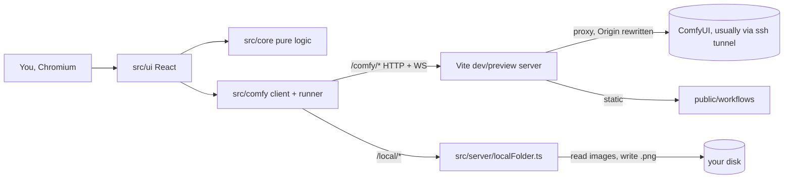

# comfy-edit — architecture

Last checked against: `7f12463` on 2026-11-13

## Purpose and boundaries

A single-page image editor for one person on their own machine: draw on an image, send it through a
ComfyUI workflow with an instruction, draw on the result, repeat, with every image of the session one
click away. Design record: `specs/001-comfy-edit/` (`specs/001-comfy-edit/plan.md`, `specs/001-comfy-edit/research.md`,
`specs/001-comfy-edit/data-model.md`, `specs/001-comfy-edit/contracts/`); project rules: `.specify/memory/constitution.md`. Not a Bun-family app (see
`~/workspace/architect/FAMILY.md` for how it sits beside the others).

**Out of scope:** accounts, sharing, deployment, persisting images or history across a reload,
installing models or managing the GPU box (cloudgpu does that), and talking to ComfyUI any way other
than the `/comfy/*` proxy.

## Components and data flow



| Component | Where | Does |
|---|---|---|
| UI | `src/ui/`, `src/App.tsx` | React wiring; `src/ui/useEditor.ts` holds the one reducer, the run lock and batch loop |
| Core | `src/core/` | Pure functions: shapes, undo/redo, history, workflow patching, the ComfyUI protocol as a reducer |
| ComfyUI client | `src/comfy/client.ts` | Every `fetch`: `/comfy/*` (upload, prompt, history, view, interrupt), `/local/*`, `/workflows/*` |
| Run orchestrator | `src/comfy/runner.ts` | One transformation: upload, patch, queue, poll `/history` to done, fetch result; deadline and cancel |
| Local folder server | `src/server/localFolder.ts` | Vite plugin (dev and preview): `/local/dirs`, `/images`, `/thumb`, `/file`, `/save`; its middleware runs the cross-site guard first, for `/comfy/*` as well as `/local/*`, ahead of Vite's proxy |
| Cross-site guard | `src/server/requestGuard.ts` | `isCrossSite`: one pure function deciding from `Sec-Fetch-Site`, else `Origin` against `Host`; called by the local folder middleware (403) and the proxy's `bypass` hook (WebSocket upgrades, 404) |
| Proxy | `vite.config.ts` | `/comfy` → `COMFY_URL` (default `http://127.0.0.1:8188`), strips prefix, `ws: true`, rewrites `Origin`; `bypass` refuses cross-site WebSocket upgrades |
| Workflows | `public/workflows/` | `public/workflows/manifest.json` + API-format graphs + optional `public/workflows/loras.json`; validated at startup |
| Test ids | `src/testids.ts` | Shared by components and e2e specs, so a renamed selector is a compile error |
| Fake ComfyUI | `tests/fake-comfy/server.mjs` | Contract double: real queue, scriptable stall, `/interrupt`, `/__test/*` control (`/__test/seen` logs every request that arrived); rejects foreign `Origin` |

## Where state lives

| State | Where | Survives a crash? | Backed up? |
|---|---|---|---|
| Image, marks, undo stacks, session history | Browser memory (`useEditor` reducer, `ImageBitmap`s, blob URLs) | No: a reload empties it (deliberate; unsaved results are warned about) | No |
| Chosen open and save folders | Browser `localStorage` keys `comfy-edit.imagesDir`, `comfy-edit.saveDir` | Yes | No |
| Saved images | Whatever folder you chose, written by `/local/save` | Yes (on disk) | No (yours to manage) |
| Workflow configuration | `public/workflows/` in the repo | Yes (git) | git |
| Uploaded inputs, queue, outputs | On the ComfyUI host | ComfyUI's concern | No |

No database, so no migrations.

## Trust boundaries

| Actor | Gets in by | Can | Can't |
|---|---|---|---|
| You | Browser on the dev server (`npm run dev`; Vite binds loopback only unless `--host`) | Everything in the UI; browse any directory the server's user can read; save a PNG into any directory it can write | Overwrite a file (`wx`); write a non-PNG or into a subfolder; read a non-image via `/local/file` |
| ComfyUI | Answers the proxy | Return any image or error, which the app displays | Reach the browser except through `/comfy/*`; the result's filename only ever goes back to ComfyUI's own `/view`, never to local disk |
| Another process on this machine | `127.0.0.1:<port>` with no auth | All of the above: list directories, read images, save PNGs | Same limits as you |
| A website you visit | Your browser, cross-origin | Reach everything outside `/comfy/*` and `/local/*` (the app's own static files and Vite's dev endpoints), without reading the responses: Vite answers preflights without `Access-Control-Allow-Origin` | Use `/comfy/*` or `/local/*`: `isCrossSite` (`src/server/requestGuard.ts`) refuses `Sec-Fetch-Site: cross-site`/`same-site`, and without that header a non-GET or a WebSocket handshake with a foreign `Origin`; HTTP gets 403 before the proxy or any route runs, a WebSocket upgrade gets 404 from the proxy's `bypass`. Pass Vite's Host check (a foreign `Host` gets 403), so DNS rebinding is blocked. Not refused: a plain GET from a browser too old to send `Sec-Fetch-Site` (it sends no `Origin` on one either) |

No secrets: there are no tokens or keys; `COMFY_URL` comes from the environment or a local .env file (see `.env.example`).

## Invariants

| # | Invariant | Enforced by |
|---|---|---|
| I1 | `src/core/` imports nothing from the DOM, the network or React | **unenforced:** true by grep at `55b34ac`, but `tsconfig.json` gives every file the DOM lib and there is no import lint rule |
| I2 | ComfyUI's results are fetched same-origin, through `/comfy/*`, so the canvas is never tainted | `tests/e2e/proxy.spec.ts`: "serves generated images same-origin so the canvas is never tainted" (checks the URL only; the pixel reads in `tests/e2e/us2-transform.spec.ts` would throw if tainted) |
| I3 | The proxy rewrites `Origin` to the target (ComfyUI 0.31+ refuses others; so does the fake) | `tests/e2e/us2-transform.spec.ts`: "AS2: running replaces the workspace image with the result" (flaky: its first line reads the canvas before the fixture is painted, 3 failures in ~13 runs; the Origin part never failed) |
| I4 | The WebSocket upgrade reaches ComfyUI as `/ws`, not `/comfy/ws` | `tests/e2e/proxy.spec.ts`: "forwards the websocket upgrade to /ws, not /comfy/ws" |
| I5 | Completion is decided by polling `/history`; the WebSocket is progress only | `tests/e2e/us2-transform.spec.ts`: "FR-027: the run still completes when the progress channel drops" |
| I6 | One run at a time: the lock is taken in the click, so a double-click queues one job | `tests/e2e/r9-run-ownership.spec.ts`: "double-clicking Run queues one job and adds one history entry" |
| I7 | A run's result belongs to the image it started on: it never replaces a newly opened or selected image | `tests/e2e/r9-run-ownership.spec.ts`: "opening a file mid-run: the old result never replaces a new image", "selecting a history entry mid-run: the result does not land on the other image" |
| I8 | Every fetch of a run carries the deadline, so a stalled connection ends in a visible error | `tests/e2e/r9-run-ownership.spec.ts`: "a connection stalled on /history ends past the deadline in a visible error, with Run enabled and no reload" (also `/upload/image`, `/view`) |
| I9 | Cancel aborts the fetches, asks ComfyUI to `/interrupt`, and leaves image and history as they were | `tests/e2e/r9-run-ownership.spec.ts`: "Cancel aborts the fetches, records /interrupt, and leaves image and history as they were" |
| I10 | Unsaved results are never dropped without a warning | `tests/e2e/r9-run-ownership.spec.ts`: "opening a file over an unsaved result warns first; declining keeps it, accepting proceeds" |
| I11 | Selecting a history entry never removes one | `tests/unit/history.test.ts`: "never removes an entry, so branching cannot destroy the path branched from" |
| I12 | Patching a workflow never mutates the graph and never invents an input | `tests/unit/workflow.test.ts`: "does not mutate the input graph, so consecutive runs cannot accumulate state", "refuses to create an input key that does not already exist" |
| I13 | Only `type: "output"` images are taken as the result; another prompt's messages are ignored | `tests/unit/comfyEvents.test.ts`: "skips PreviewImage temp outputs and returns the real result", "ignores messages belonging to another prompt" |
| I14 | Adding a workflow needs no code change; a bad manifest is reported at startup and blocks running | `tests/e2e/workflow-config.spec.ts`: "the new workflow appears and runs, with src/ untouched"; `tests/e2e/us2-transform.spec.ts`: "AS7: a malformed manifest is reported at startup and blocks running" |
| I15 | `/local/file` and `/local/thumb` serve only images inside the chosen folder | `tests/unit/localFolder.test.ts`: "refuses to escape the root via %s" (5 cases); `tests/e2e/local-folder.spec.ts`: "refuses to escape the chosen folder", "refuses a non-image inside the folder" |
| I16 | `/local/save` writes only a PNG directly inside the chosen absolute folder, never overwriting | `tests/unit/localFolder.test.ts`: "refuses %s" (6 cases, under resolveSaveTarget); `tests/e2e/save.spec.ts`: "refuses to write outside the chosen folder", "refuses to overwrite, and says which name is taken" |
| I17 | Symlinks are neither listed nor served | **unenforced:** `listImages` skips them and `/local/file` uses `lstat`, but no test makes a symlink |
| I18 | A request from another website never reaches a `/local/*` route or ComfyUI through `/comfy/*` (HTTP or WebSocket); the check runs before the proxy rewrites `Origin` | `tests/e2e/cross-site.spec.ts`: "a cross-site POST to /comfy/prompt (Sec-Fetch-Site: cross-site) gets 403 and never reaches ComfyUI", "a cross-site POST to /comfy/prompt (a foreign Origin and no Sec-Fetch-Site) gets 403 and never reaches ComfyUI", "a cross-site POST to /local/save (Sec-Fetch-Site: cross-site) gets 403 and writes no file", "a cross-site POST to /local/save (a foreign Origin and no Sec-Fetch-Site) gets 403 and writes no file", "a cross-site WebSocket to /comfy/ws is refused and ComfyUI sees no upgrade"; the decision table in `tests/unit/requestGuard.test.ts` (dev server only: see Unverified for preview) |

## Decisions

- 2026-08-09 · Frontend-only SPA behind a Vite proxy; core kept pure · test-first without a browser, same-origin images · `specs/001-comfy-edit/research.md` D1, D7
- 2026-08-09 · Poll `/history` for truth, WebSocket for progress only · less code than a reconnect machine, survives dropped sockets · `specs/001-comfy-edit/research.md` D5
- 2026-08-09 · A fake ComfyUI backs the whole suite; one opt-in `@live` test · ComfyUI is remote and billed · `specs/001-comfy-edit/research.md` D6
- 2026-08-09 · Proxy rewrites `Origin` · ComfyUI 0.31+ returns 403 otherwise · commit `e1f4b33`
- 2026-08-21/22 · Added a local-folder server (`src/server/localFolder.ts`, `sharp` thumbnails, save) · open and save images ComfyUI never saw · commits `8814bfe`, `09fc354`. **Drift:** `specs/001-comfy-edit/plan.md` still says "no application backend" and "nine packages"
- 2026-08-21/22 · Folder choices kept in `localStorage` · reopen where you were · commits `8814bfe`, `09fc354`. **Drift:** `specs/001-comfy-edit/plan.md`, `specs/001-comfy-edit/research.md` D3 and `README.md` say nothing is persisted; still true of images and history
- 2026-11-07 · R9: a run belongs to its image, lock at the click, deadline on every fetch, Cancel sends `/interrupt`, warn over unsaved results · commits `8684eb1`..`55b34ac`. **Drift:** `/interrupt` is not in `specs/001-comfy-edit/contracts/comfyui-api.md`
- 2026-11-13 · R17: refuse cross-site requests on `/comfy/*` and `/local/*` by `Sec-Fetch-Site`, else `Origin` against `Host`; the `Origin` rewrite stays, so the check sits ahead of it · any site could queue a workflow or save a file · commit `7f12463`
- Drift, scope: `specs/001-comfy-edit/plan.md` lists seven core modules and four UI components; there are now 13 modules in `src/core/` and 8 components plus the `useEditor` hook in `src/ui/`

## How to verify a change

Rung 2 on the verifiability ladder (`~/workspace/architect/VISION.md`), checked 2026-11-09: one command
starts the dev server and the fake ComfyUI (`tests/fake-comfy/server.mjs`) via Playwright's `webServer`
and drives Chromium, with no GPU and no live ComfyUI. Ports are fixed (5174, 8199) but overridable with
`E2E_APP_PORT`/`E2E_FAKE_PORT` for a second checkout; there is no database, the fake is reset per test.
Not rung 3: no one-command screenshot/transcript evidence (traces are kept only on failure).

```bash
npm test                    # typecheck + vitest (tests/unit) + playwright against the fake (e2e took 2.0 min here)
npm run test:e2e            # e2e only; results also in test-results/results.json
COMFY_LIVE=1 npm run test:e2e:live   # the one @live test; needs a real ComfyUI tunnelled to :8188
```

## Unverified

- I18 with a real browser on another site: the tests and curl set `Sec-Fetch-Site`/`Origin` by hand;
  no page on a foreign origin was driven. Chromium's own (same-origin) requests pass, per the rest of the suite.
- I18 under `vite preview`: checked once by curl on 2026-11-13 (403 on `/comfy/prompt` and `/local/save`,
  404 on the `/comfy/ws` upgrade, nothing reached the fake), but the test suite runs the dev server only.
- Behaviour against a live ComfyUI (the `@live` test was not run: no GPU instance up).
- `vite preview` / `npm start` serving the same routes as dev (read in code, not run).
- That I3's test flake is only the race above: every failure was at its first assertion (canvas missing, or
  black instead of teal) right after `setInputFiles`, before any run; not traced further.
- Rung 1 (running new tests red/green against a base commit) was not exercised; the constitution
  requires it, but no script documents it.
- That `sharp` failing to load degrades to full-size thumbnails (read in code, not exercised).
