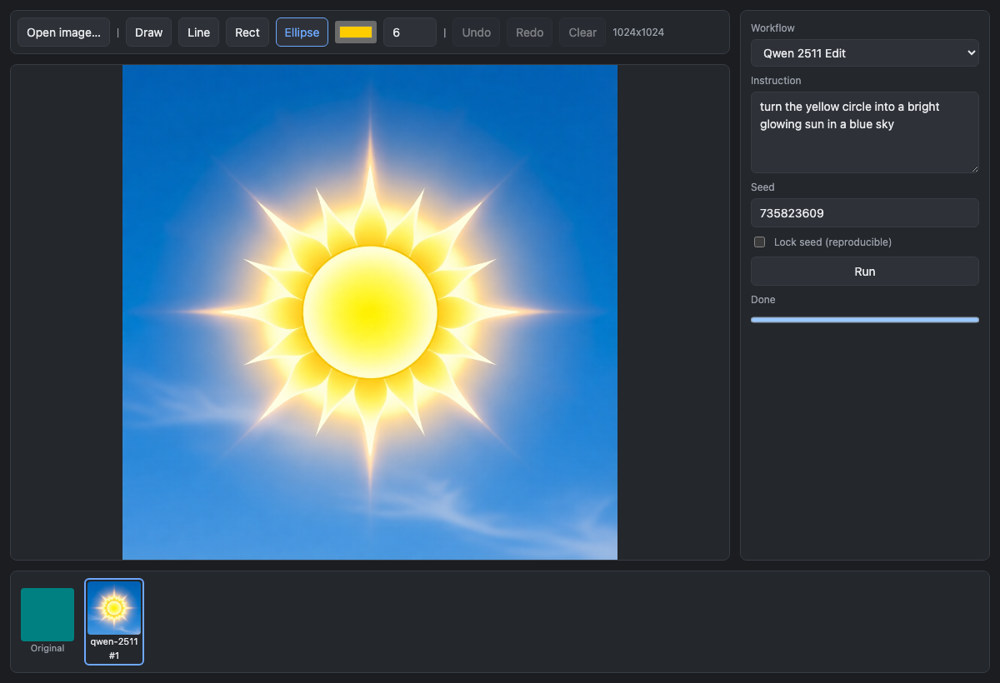

#  comfy-edit

Draw on an image, transform it through a live ComfyUI instance, draw on the result, repeat — all on
one screen. Every image the workspace has held stays one click away.

Without this, iterating means exporting from an editor, uploading to a generation tool, downloading,
and re-importing. That loop is slow enough that you stop experimenting.



## Install

```bash
npm ci
npx playwright install chromium
```

Node 22 or later. Nothing else — no GPU, no ComfyUI, no network beyond npm.

## Test

```bash
npm test
```

**This is the single command.** It runs typecheck, then the unit tests, then the end-to-end tests —
and it starts and stops both the dev server and a fake ComfyUI itself, waiting on readiness URLs
rather than sleeping. No GPU, no live instance, no manual setup. Roughly 40 seconds.

Machine-readable results land in `test-results/results.json`.

Narrower runs while working:

```bash
npm run test:unit                       # Vitest only, ~1s
npm run test:e2e                        # Playwright only
npx vitest run tests/unit/shapes.test.ts
npx playwright test tests/e2e/us1-drawing.spec.ts --headed
```

## Run it

### Against the fake ComfyUI (no GPU)

```bash
npm run fake-comfy                      # terminal 1 — binds 127.0.0.1:8199
COMFY_URL=http://127.0.0.1:8199 npm run dev    # terminal 2
```

Open an image, draw, pick **Passthrough (test)**, and Run. The fake returns a solid magenta image,
which is an unmistakable signal that upload → queue → poll → fetch → redraw all worked.

### Against real ComfyUI

The instance is remote and billed hourly, so bring it up only when you need it.

```bash
ssh -L 8188:localhost:8188 ubuntu@<ip>   # tunnel it to localhost
npm run dev                              # 127.0.0.1:8188 is the default target
```

Check the tunnel before blaming the app:

```bash
curl -s http://127.0.0.1:8188/system_stats | head -c 200
```

Terminate the instance when you're done — it bills per hour.

Once a real workflow is configured and the tunnel is open:

```bash
COMFY_LIVE=1 npm run test:e2e:live
```

That drives the same flow as the offline test against the real instance. It asserts only that the
canvas *changed*, never a specific color, because a real model's output isn't deterministic. Its job
is to catch drift in what ComfyUI expects — a changed upload response, a new WebSocket dialect —
which a fake can never catch on its own.

## Add a workflow

No code change. Verified by a test that adds one and asserts `src/` is untouched
(`tests/e2e/workflow-config.spec.ts`).

1. Get the workflow running once in ComfyUI.
2. **Workflow → Export (API)** — not a plain save. A UI-format export has a top-level `nodes` array
   and is rejected at startup with a message saying exactly this.
3. Save it into `public/workflows/`.
4. Read the node ids for the image loader, the positive prompt encoder, and the sampler. Each node's
   `_meta.title` makes this quick.
5. Add an entry to `public/workflows/manifest.json`:

```json
{
  "id": "qwen-2511",
  "label": "Qwen-Image-Edit-2511",
  "file": "qwen-2511.api.json",
  "imageNode": "78",
  "promptNode": "76",
  "seedNode": "3"
}
```

6. Reload. It's in the dropdown.

Optional `imageInput`, `promptInput`, and `seedInput` override the input names when a graph deviates
from the defaults (`image`; `prompt` then `text`; `seed` then `noise_seed`).

**`qwen-2511.api.json` is not checked in** — it's yours to export, and the models must already be on
the GPU box. The app ships working on `passthrough` alone, so nothing here is blocked on the GPU
being up. For Qwen-Image-Edit-2511 the ComfyUI template uses `LoadImage`,
`TextEncodeQwenImageEditPlus`, and `KSampler`.

Wrong node ids are reported at startup with the ids that *do* exist, rather than producing a run that
succeeds while quietly ignoring your instruction.

## How it's put together

```
src/core/     pure — no DOM, no network, no React. Every unit test lives here.
src/comfy/    I/O: the ComfyUI client and the run orchestrator.
src/ui/       React. Thin wiring, covered by the end-to-end tests.
tests/fake-comfy/  a fake ComfyUI that asserts the client's side of the contract.
```

Three decisions worth knowing before changing anything:

**`src/core/` imports nothing from the DOM, the network, or React.** All the interesting logic —
geometry, undo/redo, history, workflow patching, the ComfyUI protocol — is plain functions, so it is
unit-testable without a browser. Keep it that way; it's what makes test-first practical here.

**ComfyUI is reached only through the same-origin `/comfy/*` proxy.** Besides avoiding CORS config on
a remote box, this keeps generated images same-origin, so the canvas is never tainted. Fetch ComfyUI
directly and `getImageData` and `toBlob` both start throwing — which breaks the pixel assertions
*and* the next upload in the draw-transform-draw loop.

**Correctness never depends on the WebSocket.** It carries progress only; polling `/history` decides
whether a run finished. If the socket drops, the run still completes and you just lose the progress
bar. There's a test for exactly that.

Drawing is retained-mode: a base image plus an ordered list of shapes, fully redrawn each frame. A
completed transformation flattens — the result becomes the new base and the shapes reset, because
they're already baked into the pixels the model returned.

Nothing is persisted. History lives for the session; a reload starts empty. That's deliberate.

Full design notes are in [`specs/001-comfy-edit/`](specs/001-comfy-edit/) — `plan.md` for the
architecture, `research.md` for why each decision went the way it did, and `contracts/` for the
ComfyUI protocol and the workflow manifest format.

## Troubleshooting

| Symptom | Cause | Fix |
|---|---|---|
| `Upload failed (403)`, or 403 on every ComfyUI route | ComfyUI 0.31+ rejects requests whose `Origin` header isn't its own host | The proxy rewrites `Origin` to the target (`configure` hook in `vite.config.ts`). If you change the proxy config, keep that — `changeOrigin: true` only rewrites `Host`. |
| Run stalls at "queued" forever | WebSocket upgrade reaching ComfyUI as `/comfy/ws` | The run should still finish via history polling. Check the proxy's `ws: true` and rewrite. |
| `value not in list: …safetensors` | The model isn't on the GPU box | Download it there; this app never installs models |
| Startup banner about a workflow | Manifest node ids don't match the graph | Fix them; the banner lists the ids that exist |
| "looks like a UI-format workflow export" | Wrong export menu item | Re-export with Workflow → Export (API) |
| Result image is low-resolution | A `PreviewImage` output got picked | Selection keeps only `type: "output"` — this is unit-tested |
| Same image every run | ComfyUI cached an identical graph | Uncheck the seed lock so the seed varies |
| `SecurityError` on canvas reads | An image was fetched cross-origin and tainted the canvas | Everything must go through `/comfy/*` |
